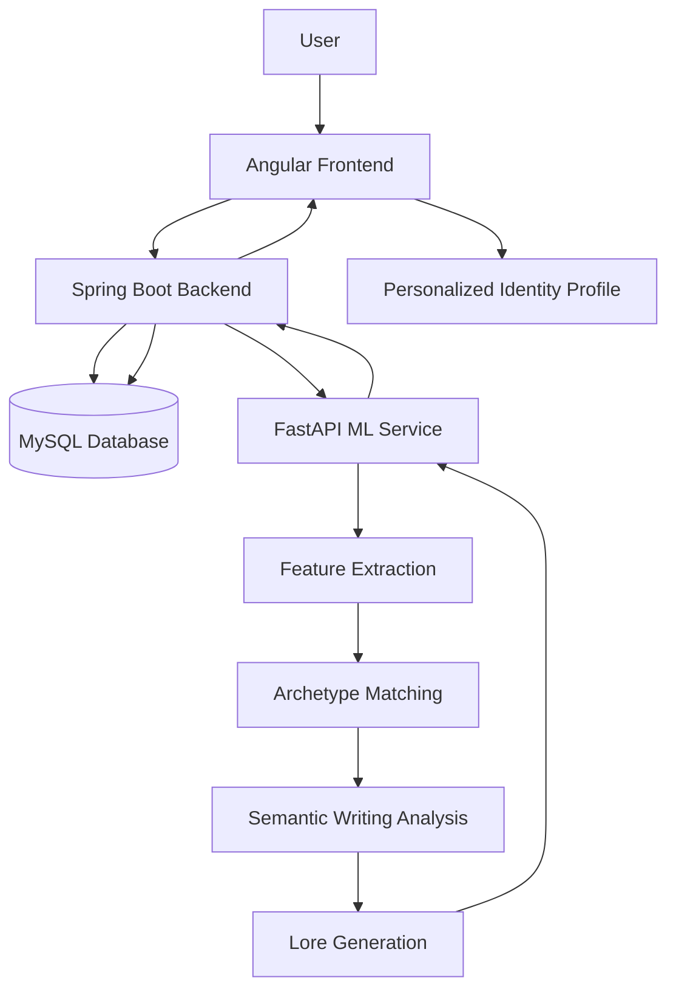

# LORE.exe — Your Digital Identity, Decoded.

<p align="center">
  <strong>An AI-powered digital identity and personality lore generator.</strong>
</p>

<p align="center">
  
  
  
  
  
</p>

---

## Overview

**LORE.exe** is an AI-powered digital identity generator that transforms a user's personality preferences, creative expression, and communication patterns into a personalized digital identity.

Users complete a 24-question interactive questionnaire and can optionally submit a writing sample for semantic analysis. The system processes their responses, extracts behavioral preference features, matches them against predefined digital archetypes, and generates a personalized identity profile.

Instead of presenting users with conventional personality-test results, LORE.exe creates an expressive digital identity featuring:

- A primary and secondary digital archetype.
- Personality-inspired trait scores.
- A personalized identity narrative.
- Aesthetic and communication-style descriptions.
- A signature quote.
- Personalized recommendations.
- A downloadable digital identity card.

**LORE.exe is designed for entertainment and self-reflection. It is not a clinical assessment or scientifically validated personality test.**

## Features

### 1. Personalized Digital Identity
- Interactive 24-question questionnaire.
- Eight personality-inspired feature dimensions.
- Twelve predefined digital archetypes.
- Primary and secondary archetype matching.
- Personalized identity generation.

### 2. Semantic Writing Analysis
- Optional writing sample submission.
- Explicit user consent before analysis.
- Sentence Transformers with `all-MiniLM-L6-v2`.
- 384-dimensional text embeddings.
- Semantic similarity analysis across six writing themes.
- Extracted themes incorporated into the generated profile.

### 3. AI-Powered Lore Generation
- Rule-based personalized narrative generation.
- Communication-style interpretation.
- Aesthetic identity generation.
- Signature quotes and recommendations.
- Visual identity representation.

### 4. Authentication and Data Management
- User registration and login.
- JWT-based authentication.
- BCrypt password hashing.
- Protected API endpoints.
- User-specific questionnaire submissions.
- Persistent personality profiles.

### 5. Interactive Frontend
- Cybercore-inspired dark UI.
- Acid-lime and electric-cyan accents.
- Responsive application pages.
- Character illustrations for all twelve archetypes.
- Downloadable identity cards.

---

## Architecture

LORE.exe follows a modular architecture with separate frontend, backend, and machine-learning services.



### Request Flow

1. The user registers or logs in through Angular.
2. Spring Boot authenticates the user and issues a JWT.
3. The user completes the questionnaire.
4. Spring Boot validates and stores the submission in MySQL.
5. Spring Boot sends the questionnaire data to the FastAPI service.
6. The ML service extracts features and performs archetype matching.
7. If consent is provided, the writing sample is analyzed using Sentence Transformers.
8. The lore generator creates the personalized identity.
9. Spring Boot stores the generated profile.
10. Angular retrieves and displays the final identity.

**Important:** Angular communicates with Spring Boot. The Python ML service is accessed internally through the backend.

---

## Technology Stack

| Layer | Technologies |
|---|---|
| Frontend | Angular 21, TypeScript, HTML, CSS |
| Backend | Java, Spring Boot, Spring Data JPA |
| Authentication | Spring Security, JWT, BCrypt |
| Database | MySQL |
| ML Service | Python, FastAPI |
| Feature Engineering | NumPy, custom feature extraction |
| Semantic Analysis | Sentence Transformers, MiniLM |
| Similarity Matching | Cosine similarity |
| Testing | Pytest, Spring Boot tests |

---

## Project Structure

```text
LORE.exe/
│
├── lore-frontend/
│   ├── public/
│   └── src/
│       ├── app/
│       │   ├── components/
│       │   ├── guards/
│       │   └── services/
│       ├── assets/
│       │   └── characters/
│       └── styles.css
│
├── lore-backend/
│   ├── src/
│   │   ├── main/
│   │   │   ├── java/com/lore/backend/
│   │   │   │   ├── config/
│   │   │   │   ├── controller/
│   │   │   │   ├── dto/
│   │   │   │   ├── entity/
│   │   │   │   ├── exception/
│   │   │   │   ├── repository/
│   │   │   │   └── service/
│   │   │   └── resources/
│   │   │       └── questionnaire.v1.json
│   │   └── test/
│   └── pom.xml
│
├── ml-service/
│   ├── app/
│   │   ├── api/
│   │   ├── data/
│   │   ├── engine/
│   │   ├── features/
│   │   ├── lore/
│   │   ├── semantic/
│   │   └── main.py
│   ├── tests/
│   └── requirements.txt
│
├── lore-spec/
│   ├── questionnaire.v1.json
│   └── README.md
│
└── README.md
```

---

## Machine Learning Pipeline

### 1. Feature Extraction

Questionnaire responses are converted into eight normalized feature dimensions:

| Feature | Description |
|---|---|
| Social Energy | Social interaction preferences |
| Curiosity | Interest in exploration and discovery |
| Creativity | Creative expression preferences |
| Spontaneity | Preference for spontaneous experiences |
| Reflection | Reflective and introspective tendencies |
| Analytical Style | Analytical thinking preferences |
| Expressiveness | Communication and expression preferences |
| Exploration | Interest in exploring new experiences |

Feature values are normalized to a 0–100 scale.

### 2. Archetype Matching

The system compares the extracted feature vector against predefined archetype profiles.

- Weighted cosine similarity is used for matching.
- The system identifies the top two matching archetypes.
- At least four comparable dimensions are required.
- Similarity scores are ranking measures, not probabilities.

### 3. Semantic Writing Analysis

The optional writing-analysis pipeline uses:

`sentence-transformers/all-MiniLM-L6-v2`

The model generates 384-dimensional embeddings and compares the writing sample against six semantic themes:

- Creative Expression
- Curiosity and Exploration
- Nostalgia and Memories
- Reflection and Introspection
- Humour and Playfulness
- Storytelling

The resulting themes contribute additional context to the generated identity.

### 4. Lore Generation

A deterministic, rule-based generation engine combines the extracted features, archetype matches, and optional writing-analysis results to generate the final identity.

This approach allows the application to produce personalized results without depending on a paid generative AI API.

---

## Getting Started

### Prerequisites

Install the following:

- Node.js and npm
- Angular CLI
- Java 21
- Maven
- Python 3.11 or compatible version supported by the dependencies
- MySQL 8.0 or later

### 1. Clone the Repository

```bash
git clone https://github.com/Jeyninn/Lore.git
cd Lore
```

### 2. Set Up the MySQL Database

Start your MySQL server and create the database:

```sql
CREATE DATABASE lore_db;
```

Configure your database connection in the Spring Boot application's configuration.

### 3. Configure the Spring Boot Backend

Navigate to the backend:

```bash
cd lore-backend
```

Configure the following properties using your local environment configuration:

```properties
spring.datasource.url=jdbc:mysql://localhost:3306/lore_db
spring.datasource.username=${DB_USERNAME}
spring.datasource.password=${DB_PASSWORD}

spring.jpa.hibernate.ddl-auto=update

jwt.secret=${JWT_SECRET}
jwt.expiration=86400000

ml.service.base-url=http://127.0.0.1:8000
```

Set the required environment variables before starting the backend.

Generate a secure Base64-encoded JWT secret, for example:

```bash
openssl rand -base64 32
```

Start the backend:

```bash
./mvnw spring-boot:run
```

The Spring Boot service runs on:

`http://localhost:8080`

### 4. Set Up the Python ML Service

Open another terminal:

```bash
cd ml-service
```

Create and activate a virtual environment:

```bash
python3 -m venv .venv
source .venv/bin/activate
```

Install dependencies:

```bash
pip install -r requirements.txt
```

Start FastAPI:

```bash
uvicorn app.main:app --host 127.0.0.1 --port 8000 --reload --reload-dir app
```

ML service:

`http://127.0.0.1:8000`

API documentation:

`http://127.0.0.1:8000/docs`

### 5. Set Up the Angular Frontend

Open another terminal:

```bash
cd lore-frontend
```

Install dependencies:

```bash
npm install
```

Start Angular:

```bash
ng serve
```

Frontend:

`http://localhost:4200`

### Running the Complete Application

Run all three services simultaneously:

| Service | Port |
|---|---|
| Angular | 4200 |
| Spring Boot | 8080 |
| FastAPI | 8000 |

Ensure that the frontend API URLs, backend database configuration, JWT configuration, and ML service URL match your local environment.

---

## API Endpoints

The main backend API endpoints include:

| Method | Endpoint | Purpose |
|---|---|---|
| POST | `/api/v1/lore/users` | Register a user |
| POST | `/api/v1/lore/login` | Authenticate a user |
| GET | `/api/v1/lore/questions` | Retrieve questionnaire |
| POST | `/api/v1/lore/submissions` | Submit questionnaire |
| GET | `/api/v1/lore/submissions/{id}` | Retrieve submission |
| POST | `/api/v1/lore/submissions/{id}/analyze` | Generate personality profile |
| GET | `/api/v1/lore/profile` | Retrieve latest profile |
| GET | `/api/v1/health` | Backend health check |

Python ML endpoints:

| Method | Endpoint | Purpose |
|---|---|---|
| GET | `/api/ml/v1/health` | ML service health check |
| POST | `/api/ml/v1/analyze` | Analyze questionnaire and optional writing sample |

Protected endpoints require a valid JWT bearer token.

---

## Testing

The Python ML service includes tests for:

- API request validation.
- Feature extraction.
- Archetype matching.
- Lore generation.
- Semantic writing analysis.

Run the Python test suite:

```bash
cd ml-service
source .venv/bin/activate
pytest -v
```

The application has also been tested locally for authentication, user data isolation, questionnaire validation, writing consent, and ML service failure handling.

---

## Privacy and Security

LORE.exe incorporates the following security considerations:

- Password hashing with BCrypt.
- JWT-based authentication.
- Protected user-specific endpoints.
- Questionnaire validation.
- Explicit consent for optional writing analysis.
- Separation of frontend, backend, and ML services.

Raw writing samples are not intended to be persisted by default. The application should be deployed with secure environment variables, HTTPS, restricted CORS, and appropriate production logging.

Never commit database passwords, JWT secrets, private keys, or environment files.

---

## Future Improvements

- Production deployment with publicly accessible services.
- Containerization using Docker.
- Improved ML model evaluation.
- Expanded archetype library.
- Additional identity customization.
- Enhanced analytics and profile history.
- CI/CD pipeline and automated integration testing.

---

## Project Status

**Core implementation complete. Local testing completed. Production deployment pending.**

LORE.exe is an independent full-stack AI/ML portfolio project built to explore the integration of frontend engineering, backend development, database design, feature engineering, and semantic NLP.

---

## Author

**Jeynang Gogoi**

B.Tech — Computer Science and Engineering

GitHub: [@Jeyninn](https://github.com/Jeyninn)

---

*Decode your patterns. Discover your lore. Welcome to LORE.exe.*
